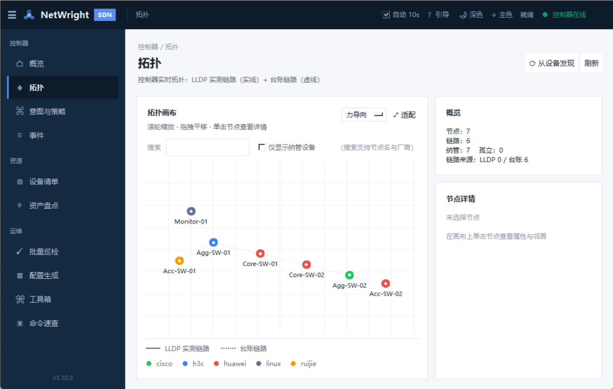
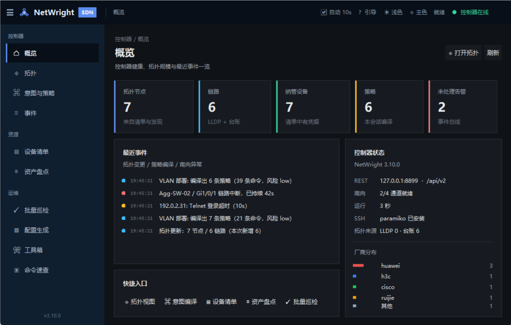

<div align="center">


# NetWright · 网络工匠

**一个单文件、免安装、面向一线的网络工程师工作台 —— 也是一台能跑起来的轻量 SDN 控制器控制台**<br/>
设备清单 · 拓扑发现 · 意图→策略 · 批量巡检 · 配置生成 · 日常工具，全在同一个程序里

<sub>[**English**](README.md) · [**简体中文**](README.zh-CN.md) · [**使用指南**](docs/USER_GUIDE.zh-CN.md)</sub>

<a href="https://github.com/Yata-Datacom/NetWright/releases"></a>
<a href="https://github.com/Yata-Datacom/NetWright/actions/workflows/ci.yml"></a>
<a href="https://github.com/Yata-Datacom/NetWright/actions/workflows/build.yml"></a>


</div>

> 网络工程师的日常被切成七八个工具：Excel 记台账、SecureCRT 敲命令、记事本存模板、浏览器查子网、脚本跑巡检……
> **NetWright 把这些收进一个窗口**，并且用控制台的思路组织起来 —— 一个 exe，双击就跑，不用装 Python。

<p align="center">
  
</p>

---

## ⬇️ 下载

**⬇️ 下载：** [Releases](https://github.com/Yata-Datacom/NetWright/releases) —— 单文件 Windows exe，免安装、免 Python。

**v4.0.2** · [CHANGELOG](CHANGELOG.md) · [使用指南](docs/USER_GUIDE.zh-CN.md) · [开发与测试](#开发)

---

## 🎯 它解决什么问题

| 你想要的 | NetWright 给的 |
|---|---|
| 想知道网络长什么样 | **拓扑** —— LLDP 实测（实线）+ 台账（虚线），一眼看出谁连谁 |
| 想批量改配置 | **意图与策略** —— 声明"我要 VLAN 10/20"，控制器翻译成各厂商命令，先 Dry-Run 再下发 |
| 想知道设备还活着吗 | **批量巡检** —— 异常分级 + HTML 报告 + 趋势图 |
| 想套模板出配置 | **配置生成** —— 116 个内置模板，缺变量直接报错，绝不产出坏配置 |

---

## 🚀 快速开始

### 方式一：下载 exe（推荐，免 Python）

1. 到 [Releases](https://github.com/Yata-Datacom/NetWright/releases) 下载 `NetWright.exe`
2. 放到一个独立目录双击运行（数据文件会生成在同目录）
3. 第一次打开：点右上角 **「? 引导」** → **「载入演示数据」**，30 秒就能看到完整界面

### 方式二：源码运行

```bash
pip install paramiko      # 唯一运行依赖（不装也能用除 SSH 外的功能）
python main.py            # Python 3.10+
```

### 方式三：装成命令

```bash
pip install -e .          # 之后直接用 netwright 启动
```

---

## ⏱️ 5 分钟上手（新手路线）

| 步骤 | 做什么 | 为什么 |
|---|---|---|
| ① | 右上角 **? 引导 → 载入演示数据** | 用 192.0.2.x 假设备先把界面填满，不用连真机 |
| ② | 左侧 **拓扑** | 滚轮缩放、拖拽平移、点节点看邻居；实线=LLDP，虚线=台账 |
| ③ | **意图与策略 → 意图下发**，选 VLAN 部署填 `10,20`，点 **Dry-Run 预览** | 看清"将要发什么命令"，预览绝不碰设备 |
| ④ | **批量巡检** → 勾设备 → 开始 | 演示设备会显示"不可达"，这是预期行为 |
| ⑤ | 清掉演示数据，导入自己的台账 | 「设备清单 → 导入 CSV」，模板见 `docs/demo_ledger.csv` |

> 界面上任何页面都可以按 **F5** 刷新；默认 **每 10 秒自动刷新**（顶栏可关）。
> 快捷键：`Ctrl+H` 引导、`Ctrl+1…9` 切换工作区、`Esc` 关弹窗。

<p align="center">
  
</p>

---

## 🗺️ 功能地图

| 工作区 | 能力 | 适合谁 |
|---|---|---|
| **概览** | KPI、最近事件、控制器状态、厂商分布、快捷入口 | 所有人（首页） |
| **拓扑** | 力导向/环形/分层布局、缩放平移、节点检查器、搜索与"仅纳管"过滤 | 想看清网络结构 |
| **意图与策略** | 意图目录（参数化 → 运行档案）→ Dry-Run → **运行档案（下发/校验/回滚）** → 审计；REST v1/v2 | 要批量改配置 |
| **事件** | 事件流（级别过滤）、南向通道能力、下发审计 | 排障与追责 |
| **设备清单** | 增删改、CSV 导入导出、在线检测、连接测试、**配置备份**、批量操作 | 台账维护 |
| **资产盘点** | 种子设备 → LLDP/ARP → 协议探测 → 已知/新增关联 | 摸清家底 |
| **批量巡检** | 9 套方案、异常规则、HTML 报告、趋势图 | 例行体检 |
| **配置生成** | 116 模板 × 设备表、零残留校验、批量导出 | 开局/扩容 |
| **工具箱** | 子网/VLSM、端口扫描、在线检测、密码生成 | 日常零碎 |
| **命令速查** | 场景 × 厂商 CLI 备忘，即时过滤，双击复制 | 忘了命令时 |
| **时间线** | 事件 + 配置快照 + 意图运行合成时间轴 | 排障时回看"那会儿发生了什么" |
| **运维中心** | 合规检查（8 条规则，可配置）、配置漂移、路径追踪、SNMP 健康 | 日常运维与体检 |
| **设置** | REST / Syslog / Trap 端口、备份保留份数、自动刷新 | 部署到不同环境时 |

---

## 🧠 控制器内核（`netwright.sdn`）

```
            ┌──────────── 北向 ────────────┐
            │  GUI 页面      REST v1/v2     │
            └───────────────┬──────────────┘
                            │
              ┌─────────────▼─────────────┐
              │  ControllerStore（状态）   │  图 / 策略 / 统计 / 快照
              │  EventBus（事件总线）      │  订阅 + 环形历史
              │  PolicyCompiler（编译）    │  意图 → 每设备命令 + 风险
              └─────────────┬─────────────┘
                            │
        ┌───────────────────▼───────────────────┐
        │        SouthboundAdapter 注册表        │
        │  CLI(SSH/Telnet)  NETCONF  OpenFlow  RESTCONF │
        └───────────────────────────────────────┘
```

| 南向通道 | 状态 | 说明 |
|---|---|---|
| **CLI（SSH/Telnet）** | ✅ 完整实装 | 复用 `lib/ssh_client`：自动关分页、剥 Telnet IAC、裁剪回显 |
| **RESTCONF** | ✅ 完整实装 | GET/PATCH/POST/DELETE + Basic Auth，TLS 可配，面向 SONiC/云网设备 |
| **NETCONF** | ✅ 实装（需 `ncclient`） | get-config / edit-config / commit / discard；会话可注入，便于离线测试 |
| **OpenFlow 1.3** | 🟡 半实装 | 流表校验 + `flow_mod` 字节编码（可 dry-run 看 hex）；TCP 通道/握手未实装 |

> 骨架的硬约定：**做不了就当场抛 `UnsupportedOperation`**，不返回空结果让上层误判"下发成功"。

### 意图生命周期（借鉴 ONOS）

```
compiled → planned → approved → deploying → deployed → verified
                                    │                      │
                                    └── failed             └── rolled_back / rollback_blocked
```

- **预演不连设备**：`plan()` 只做静态检查（命令、风险、能否回滚）
- **回滚要诚实**：VLAN 部署 / 端口 shutdown 生成确定安全的反向命令；
  端口模式互转、BGP 邻居、管理面基线直接返回"不可回滚 + 人工处置建议"
- **下发后校验**：回读 `display vlan` / `show vlan brief`，确认意图真的生效

### 事件源（不止操作日志）

| 来源 | 端口 | 能力 |
|---|---|---|
| Syslog | UDP 5140 | RFC3164/5424 解析，归类链路 down/up、BGP/OSPF、配置变更、登录失败、硬件告警 |
| SNMPv2c Trap | UDP 1162 | 自实现 BER 解码（不依赖 pysnmp），linkDown/linkUp/coldStart/authFailure |
| 控制器自身 | — | 拓扑变更、策略编译、下发、校验、回滚、token 轮换 |

事件命中的节点会在拓扑页画**琥珀色脉冲圈**（90 秒内），自动刷新时自然消退。

### 北向 REST v2（带 token）

```bash
TOKEN=$(curl -s localhost:8899/api/v2/health | jq -r .api_token 2>/dev/null)  # 见 GUI「REST API」页
curl -H "Authorization: Bearer $TOKEN" http://127.0.0.1:8899/api/v2/snapshot
curl -X POST -H "Authorization: Bearer $TOKEN" -H "Content-Type: application/json" \
     http://127.0.0.1:8899/api/v2/intents/plan \
     -d '{"intent_key":"vlan_deploy","params":{"vlans":"10,20"}}'
curl -X POST -H "Authorization: Bearer $TOKEN" http://127.0.0.1:8899/api/v2/intents/deploy \
     -d '{"run_ids":["pol-0001"]}'
```

完整端点见 [使用指南 · 12. REST API](docs/USER_GUIDE.zh-CN.md#12-rest-api)；
分层与取舍见 [架构文档](docs/ARCHITECTURE.md)。

---

## 🔐 数据与安全

| 文件 | 内容 | 安全策略 |
|---|---|---|
| `netwright_devices.json` | 设备清单 | 密码 **DPAPI 加密**（仅本机当前用户可解） |
| `netwright_settings.json` | 主题/端口等偏好 | 无敏感信息 |
| `netwright_audit.log` | 下发审计 | 含 password 的参数不入日志 |
| `netwright_controller.json` | 拓扑与策略快照 | 只有设备名/端口/链路 |
| CSV 导出 | 台账 | **默认不含密码**（需要备份凭据请用清单文件） |
| `backups/<设备>/*.cfg` | 配置快照（diff 用） | **含配置，可能有机密**：注意目录权限，勿提交 |

- REST 默认只监听 `127.0.0.1`；`/api/apply` 必须显式 `"confirm": true`
- SSH 默认 `AutoAddPolicy`（内网工具定位），严格校验请改 `lib/ssh_client.py`
- 巡检/扫描/下发**仅限授权网络**，见 [SECURITY.md](SECURITY.md)

---

## 📁 项目结构

```
NetWright/
├─ main.py                      # 启动入口（薄壳）
├─ src/netwright/
│  ├─ app.py                    # 外壳：顶栏 / 分组侧栏 / 主题 / 自动刷新
│  ├─ theme.py                  # 设计令牌（含深色外壳 chrome*）
│  ├─ widgets.py                # 组件库：PageHeader / SectionCard / StatTile / Tag …
│  ├─ demo.py                   # 一键演示数据
│  ├─ sdn/                      # 控制器内核（事件/图/策略/仓库/南向/REST v2）
│  ├─ lib/                      # 纯逻辑：清单、巡检、生成、计算、意图、拓扑解析
│  └─ pages/                    # 12 个工作区页面 + 新手引导 + 设置
├─ templates/                   # 116 个配置模板 + library.json
├─ tests/                       # 396 项 pytest（含 GUI 冒烟）
├─ docs/                        # 用户指南 + 启动基准 + 示例台账 + 截图
└─ tools/                       # 图标生成、模板导入、启动基准（bench_startup）
```

---

## 🛠️ 开发

```bash
python -m venv .venv
.venv/Scripts/pip install -e ".[dev]"     # Windows；Linux/macOS 用 .venv/bin/pip

pytest tests/ -v                          # 396 项，含 GUI 冒烟（无显示环境自动跳过）
ruff check src tests main.py              # 核心规则 lint
python tools/make_icon.py                 # 重新生成图标
```

### 打包

两种产物，按场景选：

| 产物 | 命令 | 体积 | 双击→窗口 | 适用 |
|---|---|---|---|---|
| 单文件 | `pyinstaller NetWright.spec --noconfirm` | 19.3 MB | 2.4–2.9 s | 发给别人 |
| 目录版 | `pyinstaller NetWright-onedir.spec --noconfirm` | 45.7 MB / 1107 文件 | **0.6 s** | 自己日常用 |

一键出两份（产物在 `dist/`）：

```powershell
powershell -ExecutionPolicy Bypass -File tools\build_all.ps1            # 构建并报告体积
powershell -ExecutionPolicy Bypass -File tools\build_all.ps1 -NoBuild   # 只报告已有产物
```

> PowerShell 7 用户也可以用 `pwsh tools/build_all.ps1`。脚本以 UTF-8 BOM 保存，
> 兼容 Windows PowerShell 5.1（无 BOM 时中文会被按 ANSI 解析而报语法错）。

- onefile 每次启动都要把整包解压到 `%TEMP%`，再叠加杀软扫描，所以慢；
  onedir 只在构建时解压一次，启动直接读文件。
- 两份都带 `templates/`（116 个模板）与 `assets/`。**只读资源**优先取打包内置
  （`_MEIPASS`），**可写数据**（清单/设置/审计/备份）落在 exe 同级目录，升级不丢数据。
- `upx` 已关闭：压缩会拖慢启动，且更容易被杀软误报。
- 已裁掉用不到的 PIL AVIF 插件（省 5.2 MB）；界面只需 PNG/ICO 预览。

代码约定见 [CONTRIBUTING.md](CONTRIBUTING.md)：业务逻辑放 `lib/`（可单测），页面只做装配；
颜色/间距必须来自 `theme.py` 令牌。

---

## 🧪 仓库工程化

| 关注点 | 做法 |
|---|---|
| 测试 | `pytest`（396 项，GUI 无显示环境自动跳过）；CI 双平台 × 双 Python |
| 静态检查 | `ruff check src tests main.py tools` |
| 版本一致 | `tools/check_version.py`（`__init__` / `pyproject` / `CHANGELOG` 顶部） |
| 文档健康 | `tools/check_links.py`（相对链接无死链）+ README 体积守卫 |
| 环境自检 | `tools/diagnose.py`（8 项）或 `GET /api/v4/selfcheck` |
| 打包 | `tools/build_all.ps1`（单文件 + 目录版 + SHA256SUMS） |
| 发布前 | `docs/RELEASE_CHECKLIST.md` 六步清单 |
| 数据安全 | 运行时数据/凭据/备份一律 `.gitignore`，杜绝入库 |

CI 见 `.github/workflows/ci.yml`（测试矩阵 + 文档一致性两个 job）。

## 🗺️ 路线图

- [x] v3.9 控制台外壳 + 拓扑画布 + 事件总线 + 策略编译 + 南向骨架 + REST v2
- [x] v3.17 排障时间线；v3.18 OpenFlow 1.3 flow_mod 编码 + 事件源/漂移/审计
- [x] v3.19~3.29（2026-11-02）：列表页统一组件 + 页面惰性构建（冷启动 -87%）、
  时间线联动、**配置回滚**（恢复前自动备份/失败不重试）、模板→策略闭环、
  意图→OpenFlow 流表计划、模板引擎条件/循环、**多 token**（只读 scope+轮换+来源审计）、
  巡检可取消、备份治理（zip/按设备保留/目录迁移）、设置页扩展、
  OpenFlow TCP 通道（os-ken 可选）、现网反生成模板（强制脱敏）
- [x] v4.0.x（2026-11-05）：配置 schema 迁移 + REST v4 契约冻结 + 升级/API 文档、
  仓库工程化（CI 双平台 × 双 Python、版本/死链/README 守卫）、首次公开发布
- [ ] RESTCONF 写路径 + NETCONF `edit-config`（先 SONiC / 云网设备）
- [ ] OpenFlow packet-in 事件接入（R5 已有传输层，flow 下发装 os-ken 即可用）

---

## 📄 许可

[MIT](LICENSE) · 作者 Yata-Datacom
